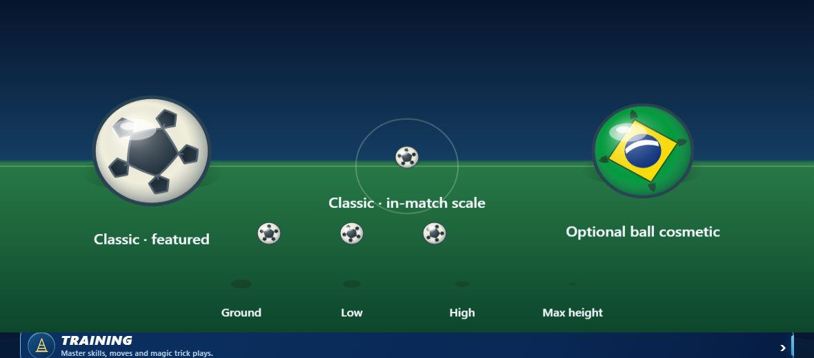

# Classic ball spherical panel projection — 4 November 2026

## Change and acceptance criteria

The classic ball's six five-sided panel faces now draw their seams as sampled great-circle arcs across the front hemisphere. This adds a subtle curved surface cue to the existing panel layout at both featured and 17-unit gameplay sizes. It preserves the 17-unit match draw radius, the supplied rotation argument, circle clip/outline, ball selection and simulation state. Other ball cosmetics and the non-gradient fallback remain unchanged.

Acceptance criteria: classic panel faces remain visible at match scale; every panel edge follows the same projection; radius, rotation and physics remain unchanged; the browser renders 0°, 45°, and 90° samples without errors; gradient-free rendering still paints a ball.

## Validation

- `python scripts/build.py`: passed; 5,131,768 JavaScript and 5,254,561 HTML characters.
- `node --test tests/game_ball_surface_render.test.cjs`: **8/8 passed**, including projection, rotation/radius, all other ball cosmetics, physics invariance and the non-gradient fallback.
- `python tests/game_ball_surface_render_browser_qa.py`: passed in headless Chromium. Captures a featured 84-unit classic ball, a 17-unit match ball, 17-unit classic turn samples at 0°/45°/90°, an optional cosmetic, and ground shadows at four heights; zero page errors.
- `npm run test:node`: build passed; **2,179/2,179 Node tests passed**; club runtime integrity fixture passed (32 clubs, 384 player slots).

## Visual evidence and limitations

This is an automated renderer capture. It does not establish owner visual approval, physical-device acceptance, or release/deployment readiness.
