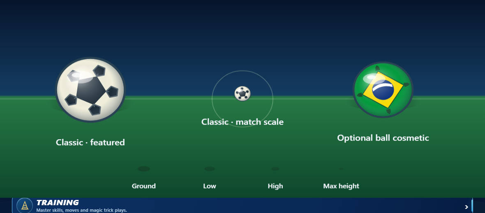

# Match ball surface quality — 4 November 2026

## Change

The existing sphere light-and-rim ramp now shades the completed ball panels. Previously it was painted beneath the panel geometry, so classic black panels and selected-color motifs stayed flat while the base sphere looked lit. The radial highlight and soft rim now add volume to all existing ball designs without changing the ball radius, rotation API, physics, collision or saved cosmetic selection. Browsers without Canvas gradients retain the existing fallback.

The ball's ground shadow now shrinks in width and height and fades as ball height increases. At ground contact, its original 15×7 footprint and opacity remain exact; a ball held by the goalkeeper still uses the existing no-ground-shadow path.

The classic ball's five surrounding dark patches now use inward-facing pentagons that meet the center panel, replacing the floating six-sided spots. This makes the panel layout read as one connected ball surface at featured size while keeping the same radius, rotation, collision, and cosmetic behavior.

Candidate .81.20 adds a fine seam around the center pentagon so its edge reads consistently with the surrounding panels at the 15-unit gameplay radius. The seam is drawn within the clipped ball surface and does not alter geometry or physics.

## Validation

- Acceptance: lighting overlays panel art, every existing model keeps its circular gameplay radius and outline, legacy no-gradient fallback remains valid, ball cosmetic selection does not affect physics, and airborne shadows become tighter/lighter while ground contact stays exact.
- Build: `python -X utf8 scripts/build.py` passed.
- Focused Node: ball surface, shot ball shape and country-ball regressions passed **16/16** on candidate .81.20; the panel topology and fine hub seam share the renderer's normal panel seam color.
- Actual-renderer Chromium: selected classic featured and 20-unit match-scale balls plus an optional Auriverde ball rendered without page errors. Four ground-shadow heights are also captured from the renderer.
- Follow-up classic panel regression plus country-ball checks passed **12/12**; the broader ball/cosmetic matrix now passes **16/16**. The bundled renderer rebuilt and the actual-renderer Chromium capture passed again with the connected pentagon panel layout.

## Visual evidence and limitations

The gameplay-size ball is the center sample. This is renderer QA, not owner visual approval or physical-device acceptance.
