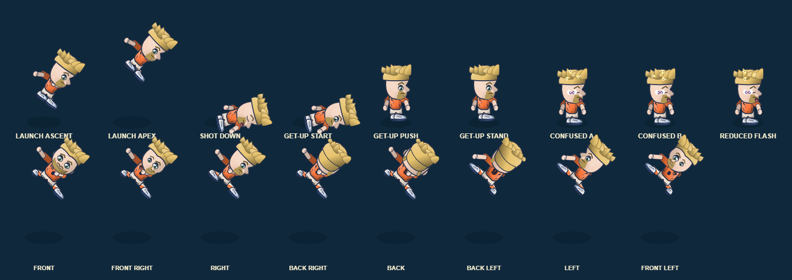
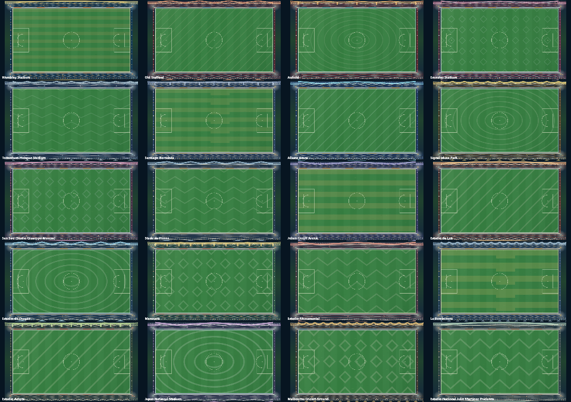

# Candidate 0.12.81.38 — local validation (5 November 2026)

## Scope

- Shot-down outfield players now plant the near hand against the pitch with open-finger detail while the far arm stabilizes the torso during the existing get-up timer. The animation blends back to neutral at both endpoints and does not affect goalkeepers.
- Pitch line markings receive a subtle dark contrast edge to remain visible across venue turf colors and patterns. Official paths, dimensions and field bounds are unchanged.
- Online Career reads the season row and fixture rows within one `REPEATABLE READ READ ONLY` transaction, avoiding a mixed-version response if a result advances the season between those reads.
- Player/ball physics, positions, collision, match results, four-button controls and offline saves remain unchanged. No new character or menu artwork was created.

## Validation run

- `python -X utf8 scripts/build.py`: passed; generated fixture size **5,141,765 JavaScript / 5,264,777 HTML characters**.
- Focused Career, pitch and shot-recovery tests: **28/28 passed**.
- Full tracked Node suite (`node --test` over tracked `tests/*.test.cjs`): **2,194/2,194 passed**.
- `node --test tests/online-career-service.test.cjs`: **13/13 passed**, including one consistent-read transaction around season/fixture projection. This uses a fake DB test seam; no live PostgreSQL concurrency test was possible.
- `python -X utf8 tests/shot_impact_reaction_browser_qa.py`: actual production renderer showed nine distinct impact/recovery/stun poses across eight heading views, with no game-state changes or browser errors. 
- `python tests/stadium_01_render_browser_qa.py`: actual production renderer covered all **20 venues**, with distinct venue artwork, persisted picker selection and no browser errors. 
- `git diff --check`: passed.
- Candidate .37 dev full regression and Modular Game Dev QA passed, its source was promoted to `main`, Pages deployment [41934226266](https://github.com/saeedsai/SuperMagicFootball/actions/runs/41934226266) passed, and main regression [41934226308](https://github.com/saeedsai/SuperMagicFootball/actions/runs/41934226308) passed. Exact-head CI, deployment, device acceptance and owner visual approval for .38 have not been run.

## Limits and remaining gates

The screenshots are automated renderer evidence, not owner visual approval. Online Career consistency was validated through the service test seam, not a configured database. The backend still needs database/OIDC configuration and a host; .37 is deployed, and .38 remains a local candidate until its exact-head release gates pass. See [online server deployment handoff](ONLINE_SERVER_DEPLOYMENT.md) and [master backlog](MASTER_BACKLOG.md).
