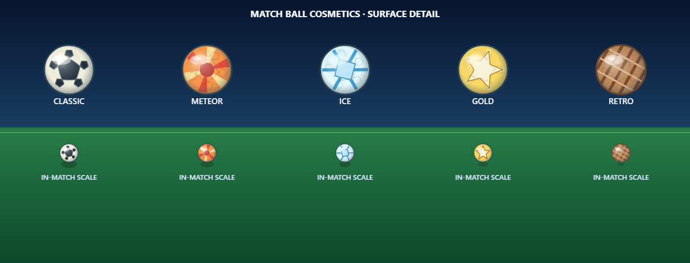

# Candidate 0.12.81.39 — validation and deployment (5 November 2026)

## Scope

- Existing Meteor, Ice, Gold, and Retro in-match balls retain their original motifs and gain curved spherical seam outlines plus restrained individual material highlights. The Classic ball's design, match radius, rotation and physics are unchanged.
- PVP terminal results can be recovered after a lost `match-finished` event or same-tab reload. The client keeps up to four deduplicated opaque match IDs, checks each against only the currently signed-in account's server history, and clears an ID after its exact idempotent token receipt is confirmed. An account switch preserves earlier pending IDs without blocking play until the four-ID cap. Leaving or disconnecting never silently discards a pending ID.
- Damaged pending-result storage preserves readable IDs and fails closed for new PVP. The online screen announces the issue and offers explicit confirmation before discarding unreadable data; a failed storage removal keeps matchmaking blocked.
- Ability controls were audited across keyboard, touch and gamepad; no input defect was found. The existing four-action schema, offline play, roster identities/order and saves remain unchanged. No home/menu or new character artwork was created.

## Validation run

- `python -X utf8 scripts/build.py`: passed; generated **5,160,473 JavaScript / 5,283,485 HTML characters**.
- Full tracked Node suite (`node --test` over tracked `tests/*.test.cjs`): **2,212/2,212 passed**.
- Focused Online History, match client/renderer, and account service/API suites: **98/98 passed**; ball rendering contract: **9/9 passed**.
- `python -X utf8 tests/online_account_ui_browser_qa.py`: passed mocked PKCE/API/WebSocket flow, lost terminal event, leave/reload/re-auth, exact-match history recovery, lost reward response and idempotent retry, preserved offline saves, four pending IDs, accessible capacity/corruption messages, and failed storage removal. This uses a mocked online service, not a live server.
- `python -X utf8 tests/game_ball_cosmetic_quality_browser_qa.py`: actual modular game over local HTTP passed for all five ball models across five rotations at 17-unit gameplay radius (25 combinations), with unchanged ball/options state and no page, console, request, or HTTP errors. All samples rendered 1,029 painted pixels and stayed within radius **18.18** (bound **18.25**). 
- `python -X utf8 tests/abilities_browser_qa.py`: desktop and simulated-mobile browser paths passed for the four-button defensive aerial action and autonomous goalkeeper. Input/engine audit passed **71/71**, six selected cross-device ability paths passed, and all ten dribble styles passed desktop and simulated-touch Player Studio checks.
- `git diff --check`: passed.
- Candidate .39 source SHA `6f8af1c0d7d49f932ff0af81fabfcff6d9e26fd6` passed Modular Game Dev QA [41944003703](https://github.com/saeedsai/SuperMagicFootball/actions/runs/41944003703) and the exact-head Full Regression Census [41944003805](https://github.com/saeedsai/SuperMagicFootball/actions/runs/41944003805). The first census attempt had one timeout in `lan_auto_two_browser_qa.py`; the local replay passed, and the exact-head rerun completed successfully. Protected promotion succeeded; main Full Regression [41948590837](https://github.com/saeedsai/SuperMagicFootball/actions/runs/41948590837) and Pages deployment [41948590410](https://github.com/saeedsai/SuperMagicFootball/actions/runs/41948590410) passed. Live smoke checks returned HTTP 200 for the game root, `sw.js`, `src/modules/release.js`, and `online-config.js`; the deployed release/service worker report `.39`. The online configuration fields remain empty, so these checks do not mean authenticated online play is live.

## Limits and remaining gates

The ball screenshot is automated renderer evidence, not owner visual approval or physical-device acceptance. Online recovery was exercised against a mocked API/WebSocket service; real database/OIDC credentials, a hosted backend, real-network two-device play, load/restore checks, and server deployment remain open. The deployed public game configuration still has empty provider settings, so authenticated online modes are not live. See [online server deployment handoff](ONLINE_SERVER_DEPLOYMENT.md) and [master backlog](MASTER_BACKLOG.md).
