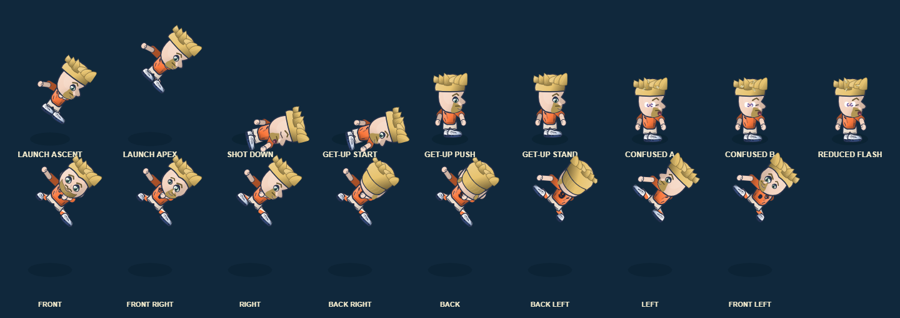

# Candidate 0.12.81.40 — local validation (5 November 2026)

## Scope

- Shot-stunned players now show three readable bird silhouettes orbiting the head. Their wings flap gently with the existing confusion timer; reduced-flash freezes wing, orbit and spiral-eye motion. The existing stun state, duration, hit response, player pose, and gameplay state remain unchanged.
- The online match client checks the browser WebSocket's buffered bytes before sending each sampled control frame. Above 1,024 bytes it drops obsolete samples without closing the match or advancing the accepted wire sequence; after drain, the latest four-action state sends using a compact monotonic sequence. This reduces stale-control backlog in congested tabs but is not a server-side or real-network guarantee.

## Validation run

- `python -X utf8 scripts/build.py`: passed; generated **5,162,559 JavaScript / 5,285,571 HTML characters**.
- Full tracked Node suite (`node --test tests/*.test.cjs`): **2,215/2,215 passed**.
- `node --test tests/shot_impact_reaction.test.cjs tests/shot_impact_gameplay.test.cjs`: **8/8 passed**, including animated/frozen bird cue checks, four-control stun behavior, knockdown bounds, and unchanged gameplay timers.
- `node --test tests/online-match-client.test.cjs tests/online-match-ws.test.cjs`: **21/21 passed**, including buffer backpressure, dropped-sample handling, recovery after drain, monotonic sequence, and unchanged four-button payload.
- `python -X utf8 tests/shot_impact_reaction_browser_qa.py`: actual game renderer produced nine distinct launch/knockdown/recovery/confusion states across all eight player views, with no browser errors and unchanged player/ball physics. The captured cues were inspected at in-game player scale. 
- `git diff --check`: passed.

## Limits and remaining gates

The renderer capture is automated/local visual evidence, not owner visual approval or physical-device acceptance. Online backpressure is tested with a mocked WebSocket client/server contract, not a live hosted API, real network, or two physical devices. Candidate .40 exact-head CI, protected promotion, Pages deployment and hosted smoke remain pending. The deployed .39 `online-config.js` fields are empty and authenticated online play is not live. See [online server deployment handoff](ONLINE_SERVER_DEPLOYMENT.md) and [master backlog](MASTER_BACKLOG.md).
