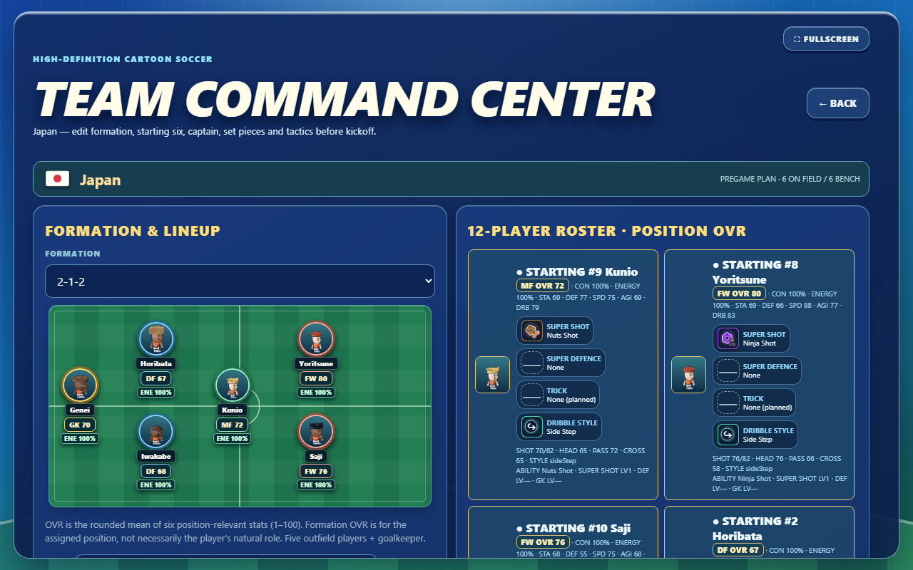

# Energy and formation readability — 4 November 2026

## Changes

- Reduced modular ongoing/action Energy drain from a `0.78` to `0.70` exertion multiplier (about 10% less). The legacy fitness path receives a roughly 10% rate/cost reduction as well.
- Discrete Breath actions cost 90% of their previous amount. The empty-Breath action multiplier is now `1.60×` instead of `1.75×`.
- Lowered the sprint Breath drain coefficient from `2.2` to `2.0`. Breath capacity, recovery rates, and the walking/jogging/sprinting order remain unchanged.
- Formation setup now shows a selected player's Energy beside position OVR, on each formation pitch slot, in all starter-selection options, and in every starter/bench roster card. The same display is shared by quick setup, Career tactics, and paused-match substitutions. Pause uses the live match fatigue ledger; setup and Career use the player's saved Energy/condition fallback. Energy labels are announced to assistive technology.
- Compact desktop sizing keeps Training above the shortcut dock. Short landscape layouts now switch to a scrollable single column, keeping Career, Cups and other mode cards reachable without the shortcut dock intercepting clicks.

## Validation

- `node --test tests/breath_hud_dribble.test.cjs tests/dual_resources.test.cjs tests/jumping_fatigue_real.test.cjs tests/lineup_role_fit.test.cjs` — **29/29 passed**.
- `node tests/fitness_substitutions.mjs` — passed.
- `node tests/defensive_pursuit_pitch.mjs` — passed.
- `python -X utf8 tests/browser_runner_compat.py tests/formation_starter_select_accessible_name_browser_qa.py` — passed with all six pregame starters, six formation positions and twelve roster cards exposing Energy.
- `python -X utf8 tests/browser_runner_compat.py tests/career_lineup_editor_browser_qa.py` — passed on desktop and simulated touch; Career Energy is present in roster, selected formation slot, accessible OVR label, and all six position badges.
- `python -X utf8 tests/browser_runner_compat.py tests/ux26_training_cross_coach_browser_qa.py` — passed desktop and simulated touch, including direct Home → Training at 1280×720.
- `python -X utf8 tests/browser_runner_compat.py tests/viz01_menu_background_overflow_browser_qa.py` — passed desktop, 390px mobile, and 320px mobile with no horizontal Home overflow.
- Short-landscape Home Career routes and the Career restart, Cup slot naming, opponent scout, season review, lineup editor, and Training browser checks pass on desktop and simulated touch after the layout fix.
- `npm run test:node` — **1,943/1,943 passed**, plus the 32-club/384-player fixture.
- `python -X utf8 scripts/validate_data.py` — **PASS**, 223 teams and 2,676 players; 84 avatar presets; no errors.
- A .81.8 browser census attempt produced 192 passes, 18 failures, and 15 tests not run after shard 1 stopped early. The Career-card overlap on short landscape was fixed and affected flows passed focused reruns. Save-import/temp-profile and simulated-touch graphics-studio failures remain open; see the [candidate report](CANDIDATE_012818_VALIDATION_20261104.md).

No roster identity, save schema, action mapping, player speed curve, match clock, Breath recovery, or offline behavior was changed. Physical-device playability and owner balance review remain open.
