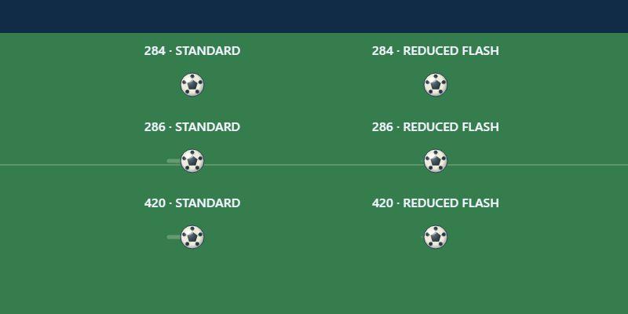

# Reduced-flash fast-pass cue — 4 November 2026

## Change

Ordinary loose-ball passes above the existing 285 speed threshold retain the standard 30-unit, alpha .25 speed streak. Reduced-flash mode uses a steady 18-unit streak at alpha .12 and 3px instead of 5px. The cue remains readable without the full bright trail. Ball position, velocity, trail data, collision, pass threshold, and gameplay remain unchanged.

## Validation

- Focused Canvas renderer, ball surface, shot-form and shot-contact checks: **13/13**.
- The actual-renderer Chromium capture samples standard and reduced-flash at speeds **284**, **286**, and **420**. The cue is absent below threshold, appears above threshold in standard mode, and has fewer/dimmer pixels in reduced-flash mode. All six samples preserve ball state; no page errors.
- Release/version contracts: **19/19**.
- Full Node suite: **1,954/1,954**.
- `python -X utf8 scripts/build.py`: passed.

## Visual evidence

This is local renderer QA, not owner visual approval, device acceptance, or deployment evidence.
