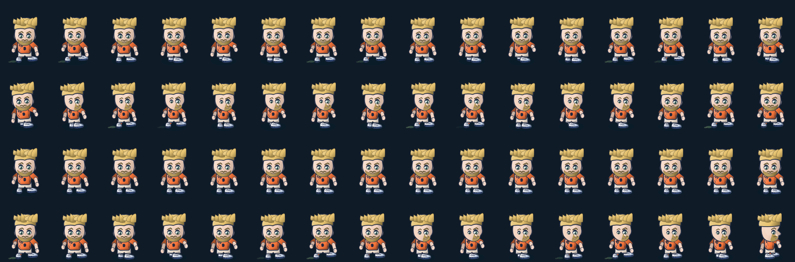

# In-game player motion transitions — 4 November 2026

## Scope

Added actual-renderer QA for continuous match movement through run, 90-degree cut, braking to a stop, and relaunch. This is a QA increment only; no player art, action timing, physics, stamina, input, save data or Home/menu character was changed. It complements the existing 288-frame, eight-heading run-cycle capture.

## Validation

- `tests/player_motion_transition_browser_qa.py`: Chromium rendered 64 frames (16 each for run, cut, stop and relaunch) through production `renderer.drawPlayer()`.
- All 16 run, cut and relaunch samples were distinct; each row retained at least 4,997 painted pixels. The stop sequence changed 4,511 pixels between its first and last samples while settling from the preceding movement.
- No page errors; the live match player and ball state snapshots were unchanged.
- The sequence is procedural-renderer evidence, not replacement character art or owner visual approval.

## Visual evidence

AssetStudio frame-local character replacements remain unapproved and blocked on source-fit scalp/hair separation and per-view/action coverage.
