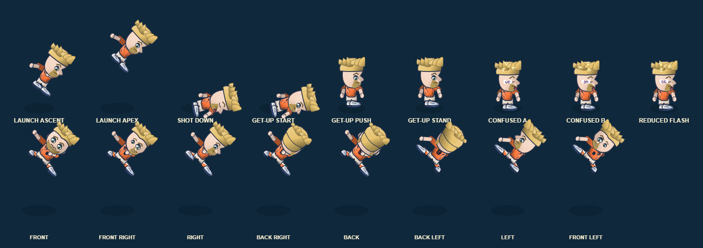

# Super Shot launch reaction — 4 November 2026

## Change

On the existing launched action, the near-side arm now folds across the head while the opposite arm extends away from the body. This avoids the previous paired overhead arm pose, which resembled a celebration during a hit. The pose is timer-driven, bounded by the existing 1.1-second launch action and strictly cosmetic. Knockback, knockdown duration, stun, hitboxes and ball/player physics are unchanged. Reduced-flash confusion behavior is unchanged.

## Acceptance and validation

- Acceptance: hit reaction has visibly different launch and grounded/recovery poses; transition is render-only and preserves the existing timer; no browser errors or gameplay-state mutation.
- `python -X utf8 scripts/build.py`: passed.
- Focused tests: `tests/super_shot_visuals.test.cjs`, `tests/shot_impact_reaction.test.cjs`, `tests/shot_impact_recovery_pose.test.cjs`, `tests/shot_impact_recovery_legs.test.cjs`: **12/12 passed**.
- `python -X utf8 tests/shot_impact_reaction_browser_qa.py`: passed in Chromium; nine distinct rendered phases (launch ascent/apex, down, get-up start/push/stand, two animated confusion phases and reduced-flash); unchanged player/ball state; zero page errors.

## Visual evidence and limits

Capture uses the live procedural fallback renderer at enlarged QA scale. It is structural visual evidence, not owner approval, production-scale perceptual signoff, or physical-device acceptance. The Studio character-art prototype remains unapproved and is not loaded as replacement production art.
