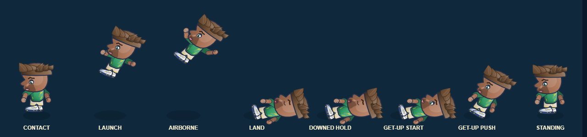

# Live Super Shot contact and recovery transition — 3 November 2026

## Acceptance criteria

- Use the shipped engine to create a real Super Shot/player collision and assert it launches the target.
- Advance the real engine through landing, the strength-scaled grounded timer, and get-up; assert state changes and hold duration.
- Render and capture eight distinct actual-player phases without browser errors.
- Keep this visual regression outside gameplay state, save data, and physics tuning.

## Result

The new `tests/shot_impact_contact_transition_browser_qa.py` fixture launches a level-4 ricochet Super Shot at a live player, then drives `GameEngine.updateBall` and `GameEngine.updatePlayers` through contact, launch, airborne, landing, downed hold, get-up start, get-up push, and standing. The observed grounded hold was **2.903 seconds**, within the requested 0.5–3 second range. All eight captured frames have distinct pixel hashes, the player transitions landed/recovered, and Chromium reported no page errors.

## Validation

- `python -X utf8 scripts/build.py`: passed.
- `python -X utf8 tests/shot_impact_contact_transition_browser_qa.py`: passed; eight distinct phases, 2.903-second grounded hold, landed/recovered, no page errors.
- `node --test tests/shot_impact_gameplay.test.cjs tests/shot_impact_reaction.test.cjs tests/shot_impact_recovery_pose.test.cjs tests/shot_impact_timing_rates.test.cjs tests/dribble_styles.mjs tests/studio_magic_counter_playbook.test.cjs`: **14/14 passed**.
- `python -X utf8 tests/shot_impact_reaction_browser_qa.py`: nine actual-renderer phases, unchanged simulation state, no page errors.

This is local Chromium evidence only. It does not establish human balance, physical-device input, or owner visual approval.
