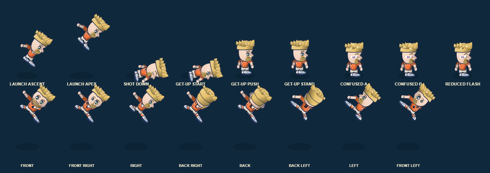

# Super Shot impact leg-flail animation — 4 November 2026

## Change

The existing launched-player reaction now moves the lower body as well as the braced/outward arms. During the established 1.1 second launch pose, the near leg kicks forward and the far leg folds back toward the body. Both follow the bounded launch pulse, so they return to neutral at its endpoints. No new action state or control was added; knockback, stun/knockdown timers, collision, hitboxes and ball/player physics are unchanged. Reduced-flash behavior remains unchanged.

## Acceptance and validation

- Acceptance: production renderer uses the existing launch pulse to create an asymmetric leg silhouette; launch/down/get-up/confusion examples remain distinct; rendering does not mutate match state.
- `python -X utf8 scripts/build.py`: passed.
- Focused `node --test tests/shot_impact_recovery_legs.test.cjs tests/shot_impact_reaction.test.cjs tests/shot_impact_recovery_pose.test.cjs tests/super_shot_visuals.test.cjs`: **13/13 passed**.
- `python -X utf8 tests/shot_impact_reaction_browser_qa.py`: passed in Chromium with **9/9 distinct reaction phases** plus visible launch poses from all **8 match headings** (at least 5,222 painted pixels per sample), unchanged player/ball state and no browser errors. The eight headings resolve to all expected facing/view-side pairs.

## Visual evidence and limits

This is a production procedural-renderer capture, not AssetStudio replacement art, owner approval, production-scale perceptual signoff, or physical-device acceptance. The source-specific character-art package remains unapproved and the procedural fallback stays active.
