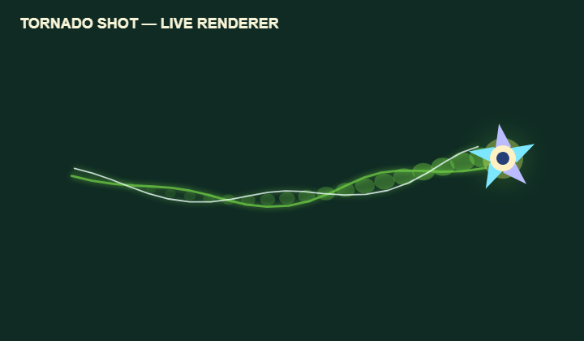

# SuperMagicFootball 0.12.21.0 local candidate QA

Run date: 1 November 2026. The checkout was on `dev`, based on `7d2d0d0c6fc4397400c3b1a8a7400faa6009c49d`, with integrated but uncommitted changes. The candidate remains local and unpromoted.

## Results

- `npm run test:node`: **1,313 passed, 0 failed**; generated runtime/test fixtures rebuilt successfully.
- Independent Node census: **331/331 scripts passed** across four shards (83, 83, 83, 82); no failures, timeouts, errors or unrun cases.
- Chromium census: **113/113 scripts passed** across four shards (29, 28, 28, 28) using the pinned isolated Playwright environment; no failures, timeouts, errors or unrun cases.
- `scripts/validate_data.py`: **PASS**, 223 teams, 2,676 players, 84 avatar presets, no errors.
- SH02 and SH03 focused live browser checks passed on desktop and simulated touch: signed/mirrored paths at 30/60/120 Hz; goal mouth scores, top/bottom crossbar misses and keeper-plane contacts; four-action HUD unchanged.
- Tornado trail unit coverage: deterministic two-strand geometry, bounded history, quieter no-glow reduced-flash rendering, and no change to other shot trails.
- The actual Chromium renderer preview was visually reviewed; the two-strand helix stays legible against the pitch and terminates at the Tornado ball.
- The full browser census includes the 12,096-case graphics sweep and Studio visual integration checks.

Per-shard reports are in [`qa_runs_01221_node`](../qa_runs_01221_node/) and [`qa_runs_01221_browser`](../qa_runs_01221_browser/). Windows runs require `PYTHONUTF8=1`; browser cases use the isolated `.qa-browser-venv` and portable Chromium path.

## Remaining gates

These results cover the local integrated source tree. Exact committed-head CI, protected promotion, deployed Pages bytes, physical Android/iOS/gamepad play, a real two-device LAN match, and human visual approval of player art remain separate. No version has been published or deployed.
